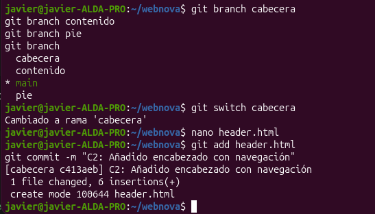
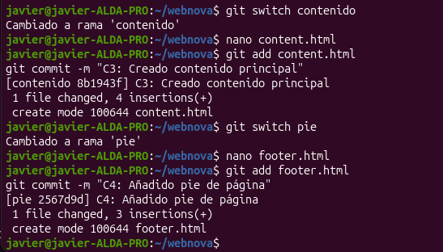
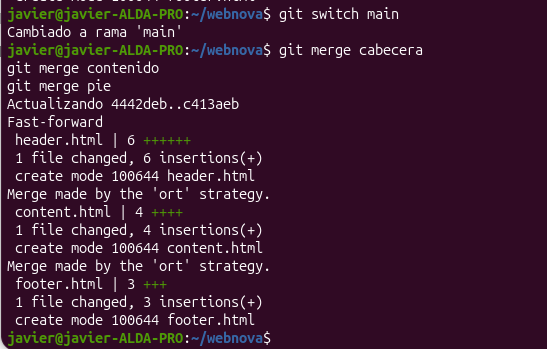
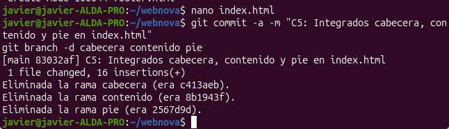
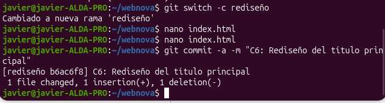
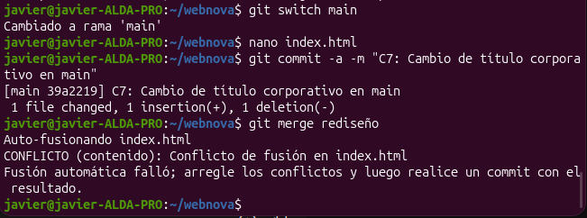
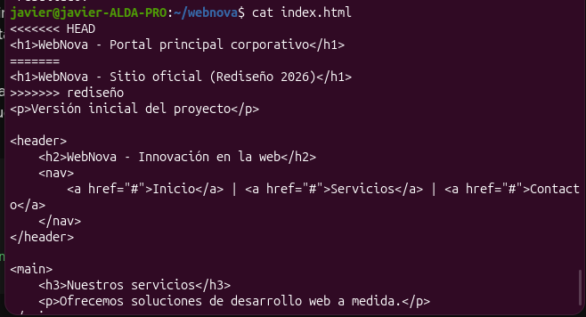
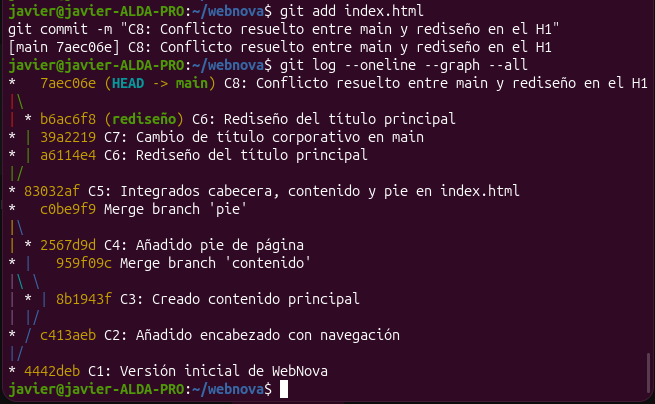

# Práctica 4. Gestión Avanzada de Ramas y Resolución de Conflictos

### Parte 0 y 1: Fase Base y Desarrollo en Paralelo
*Preparacion del entorno, creacion de ramas, commits correspondientes y fusion inicial.*
- 
- 
- 
- 
- 

### Parte 2: Resolución del Conflicto
*Conflicto modificando la misma linea en `main` y `rediseño`, visualizacion de las marcas de Git.*
- 
**Momento del conflicto:**
- 
**Estado del archivo con las marcas de Git:**
- 

### Parte 3: Visualización del Historial
*Comandos de resolucion del conflicto y salida del comando `git log --oneline --graph --all` mostrando el arbol completo.*
**Resolucion y arbol del historial:**
- 

---

## 2. Reflexión Teórica

### ¿Por qué ocurrió el conflicto en la PARTE 3 y por qué no ocurrió en la PARTE 2?
En la parte 3 ocurrio un conflicto porque se modifico exactamente la misma linea dentro del mismo archivo, pero en dos ramas diferentes.
Mientras que en la parte 2 no ocurrio nada porque se realizo las modificaciones en archivos diferentes y nuevos.

### Al ejecutar `git switch main` en la PARTE 3.2, ¿qué ocurrió con los archivos de tu directorio de trabajo?
Lo que ocurrio fue que se actualizo automaticamente para reflejar el estado de los archivos tal y como estaban guardados en la rama main.
